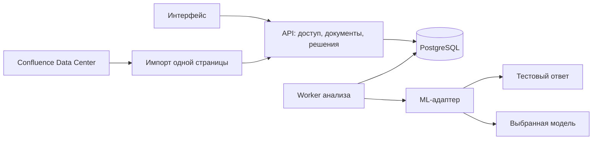

# AI Requirements Assistant — первая рабочая версия

Обновлено: 18 сентября 2026. Статус: рабочая спецификация MVP; локальный backend реализован до T03-01 включительно. Доступны документы, версии, задания с fixture-worker и ревизии решений. Preview/apply, реальный ML, настоящий вход, интерфейс и Confluence остаются планом. Подтверждённые пользователем границы отделены от предложенных технических решений.

## Цель и границы

Аналитик открывает спецификацию, проверяет её, добавляет новое требование и сохраняет выбранные изменения новой версией. Первое демонстрируемое прохождение заканчивается сохранённым документом и повторным просмотром результата после перезапуска приложения.

Пользователь выбрал Linting и Merge как кандидатов в основу MVP, исключил Team Lead Board и указал Confluence Data Center как первую интеграцию. Авторизация и онбординг нужны. Численный скоринг не утверждён.

Рабочие допущения этой спецификации: личный проект; текст/Markdown в первом техническом проходе; явный запуск анализа; изменения через preview; импорт одной страницы Confluence в пилоте; обратная запись позднее. Эти решения можно корректировать без изменения бизнес-цели. Демо на заглушке, локальный технический проход и пилот с пользователями — разные уровни готовности.

## Пользовательский путь

1. В пилоте пользователь входит в личный проект. При первом входе доступен помеченный учебный пример и вставка своего текста. Подключение Confluence предлагается при выборе источника.
2. Пользователь сохраняет документ. Backend создаёт неизменяемую версию с отдельными структурными блоками.
3. По кнопке «Проверить» запускается Linting. Результат содержит замечания, источники, возможные правки и вопросы. Пользователь может отклонить замечание или перейти к предложенной правке.
4. В Merge пользователь вводит новое требование и добавляет контекст. Номер выбранной базовой версии виден. Старый черновик изменения и актуальное объяснение имеют разные роли.
5. Система показывает понимание задачи, группы правок, основания и вопросы. В кейсе устройств она различает имя, техническую маркировку, тип и назначение; отсутствие сведений об адаптере не заполняется догадкой.
6. Пользователь принимает, редактирует, отклоняет или откладывает группы. Связанные операции внутри группы применяются целиком. Вопрос блокирует только зависимые группы; частичный результат обозначается как частичный.
7. Preview показывает полный итоговый текст и diff, включая удаления. После подтверждения backend создаёт новую версию. Исходная версия и решения сохраняются.
8. Новая версия помечается как ещё не проверенная. По явному действию запускается повторный Linting. Если исходник успел измениться, применение блокируется и предлагается повторный анализ.

## Первая реализация и готовность пилота

| Этап | Результат |
|---|---|
| Технический проход | Локальный backend: документ → версия → задание → явная ML-заглушка → решения → preview → новая версия |
| Работающая проверка | Реальный ML-адаптер и размеченные примеры; ошибки и вопросы различаются; проверена полезность замечаний |
| Пилот | Настоящий вход, интерфейс сценария, изоляция пользователей, чтение Confluence DC, восстановление после ошибок |

Завершены T01, техническая T02 и [T03-01 — ревизии решений](t03-01-result.md); независимая проверка — 468 тестов и 24 подтеста. До полного технического сценария через API с fixture остаются два цикла: T03-02 (preview/diff) и T03-03 (применение новой версии). До пилота остаются шесть крупных этапов: оставшаяся T03 и T04–T08; T07 разделена на проверку доступа и импорт.

Скоринг 0–100, рейтинги команды, автоматическое исправление всего документа, обход всех пространств и обратная запись Confluence не входят в предложенный первый проход. Поддержка DOCX/PDF остаётся отдельной задачей: локальный разбор архива не означает, что продукт уже умеет импортировать эти форматы.

## Архитектура для реализации

Локальный backend использует Python/FastAPI, PostgreSQL и отдельный worker из того же репозитория; версии зависимостей зафиксированы. Очередь и история попыток хранятся в PostgreSQL, адаптер пока выполняет воспроизводимый fixture. Подключение реального ML и выбор отдельного брокера остаются следующими решениями. Схема ниже показывает целевую архитектуру, включая ещё не реализованные интерфейс, модель и Confluence.

Отдельный worker выбран ради сохранения заданий, повторов и независимости от HTTP-запроса. Встроенные BackgroundTasks FastAPI выполняют работу после ответа; документация отдельно обсуждает вынесение тяжёлой обработки в другие процессы. Поведение очереди в PostgreSQL реализует наш backend; эти гарантии не предоставляет сам FastAPI. [Официальное описание](https://fastapi.tiangolo.com/tutorial/background-tasks/).

## Что хранит backend

| Сущность | Минимальное содержание |
|---|---|
| User / Project | Владелец и граница доступа; первое приближение — личные проекты |
| Document | Название, проект, текущая версия, ссылка на внешний источник |
| DocumentVersion | Неизменяемое содержимое, родительская версия, структурные блоки, происхождение, пропуски импорта |
| ContextRevision | Новое требование, уточнения пользователя и выбранные справочные материалы с ролями |
| AnalysisRun | Режим, версия документа/контекста, статус, попытка, lease, deadline, сведения адаптера |
| AnalysisResult | Валидированный результат по контракту: замечания, группы, вопросы, охват |
| ReviewRevision | Неизменяемый полный снимок решений и текстовых edits, родитель/номер, fingerprint исходного результата |
| Preview / ApplyOperation | Снимок выбранных правок и итогового текста, ожидаемая версия, ключ повторного запроса, созданная версия |
| Connection / SourceSnapshot | Владелец подключения, адрес DC, page ID, внешняя версия, данные происхождения; секреты не передаются модели |

Первая реализация может хранить блоки и смысловой результат в JSONB, не создавая таблицу на каждое поле. Внешние ключи, права доступа и неизменяемость версий обеспечиваются отдельно. Оригинал импортированной страницы сохраняется для сверки; unsupported-блоки и ссылки на вложения не теряются молча.

В локальной разработке секреты загружаются только из ~/secrets.env. В репозитории остаются имена требуемых настроек, без значений; новые .env с секретами не создаются. Реальное хранение пользовательских подключений и механизм входа выбираются перед пилотом.

## Задания, повторы и применение

Технические состояния: queued → running → succeeded или failed. Worker получает задание с ограниченной по времени арендой и идентификатором попытки. После его падения работу можно повторно забрать; просроченный worker не вправе перезаписать результат новой попытки. По истечении срока обработки/числа попыток сохраняется объяснимая ошибка. Значения таймаутов и лимитов задаются конфигурацией и проверяются на примерах до пилота.

succeeded означает, что возвращён валидный результат. Внутри него review_status может быть needs_clarification; это не причина повторять платный вызов автоматически. Пропуски содержимого показываются отдельным признаком неполной проверки.

В реализованной T03-01 GET review без истории возвращает виртуальную ревизию 0 со всеми группами `pending`, не записывая строки. PUT сохраняет полный снимок `pending`/`accepted`/`rejected`/`deferred` и точных правок текста существующих new_blocks. `accepted` — намерение: черновик допускает непринятые зависимости, блокирующие вопросы и конфликтующие альтернативы. Проверка применимости и создание новой версии относятся к T03-02/03.

Сохранение решений сверяет `expected_revision_id` с родителем и `expected_result_fingerprint` с исходным результатом. Точный повтор возвращает прежнюю ревизию, изменённый снимок от устаревшего родителя даёт 409. История читается по `revision_id`; ReviewResponse GET/PUT содержит 11 полей, прежний RunResponse сохраняет 14. Версии документа и исходный результат не меняются; review разрешён и по прежней базе без скрытого переноса на текущую версию. [Точный контракт](t03-01-contract.md).

При создании задания и применении правок используется ключ повторного запроса. Одинаковый ключ в рамках пользователя и операции с тем же телом возвращает прежний результат; с другим телом — конфликт. Автоматическая повторная доставка не создаёт вторую локальную версию. Внешний вызов модели при неопределённом сетевом исходе всё же может повториться и иметь стоимость; локальная идемпотентность этого не отменяет.

Применение выполняется транзакционно: проверить доступ, preview и ревизию решений; заблокировать запись документа; сравнить текущую версию с базой; создать новую версию и результат операции; обновить текущую версию. Повтор после уже успешного применения сначала разрешается через сохранённую операцию. PostgreSQL предоставляет блокировку строки FOR UPDATE; корректная последовательность и обработка конфликтов остаются обязанностью приложения. [Официальная документация](https://www.postgresql.org/docs/current/explicit-locking.html).

## Минимальный HTTP API

Таблица разделяет реализованный локальный API, уже описанный в OpenAPI, и будущие маршруты. Реализованные обращения проверяют серверные user/project и владельца задания; настоящий вход ещё не подключён. В целевом пилоте владелец берётся из проверенной сессии, не из произвольного поля тела.

| Метод | Назначение | Статус |
|---|---|---|
| GET /me | Текущий пользователь и режим окружения | Локальный режим реализован |
| POST /documents | Создать документ и первую версию из текста/Markdown | Реализован |
| GET /documents | Получить документы своего проекта | Реализован |
| GET /documents/{id}/versions/{version_id} | Прочитать конкретную сохранённую версию | Реализован |
| POST /documents/{id}/runs | Создать Linting/Merge для явной версии и контекста; вернуть 202 и run_id | Реализован, fixture |
| GET /runs/{id} | Статус и, после успеха, результат с execution_mode | Реализован, fixture |
| GET /runs/{id}/review | Прочитать текущую/виртуальную ревизию; optional revision_id выбирает историческую | Реализован, T03-01 |
| PUT /runs/{id}/review | Сохранить полный снимок с ожидаемым родителем и fingerprint | Реализован, T03-01 |
| POST /runs/{id}/clarifications | Сохранить ответы новой ревизией контекста и запустить новое задание | План, T05 |
| POST /runs/{id}/preview | Проверить выбранные группы и получить зафиксированный preview | План, T03-02 |
| POST /runs/{id}/apply | Применить конкретный preview с проверкой базовой версии и ключом повтора | План, T03-03 |
| POST /runs/{id}/retry | По явному действию повторить неуспешную техническую обработку; связать попытки | План |
| POST /connections/{id}/imports | Импортировать выбранную страницу зарегистрированного Confluence DC | План, T07b |

При ответе на уточнение базовая версия не меняется автоматически. Если она уже устарела, пользователь явно выбирает повторный анализ актуальной версии. Review, preview и apply не изменяют ответ ML задним числом.

Формат ошибки: code, понятное message, retryable и ID запроса без секретов. Основные случаи: доступ/сессия, неподдержанный формат или размер, невалидный результат ML, таймаут, устаревшая версия, конфликт выбранных правок, блокирующий вопрос, недоступный источник. Подробности чужих документов в ошибки не включаются.

## Вход, интерфейс и Confluence

Для локального прохода допустим явный тестовый пользователь с привязкой сервера к loopback и запретом такого режима в пилотной конфигурации. Это не реализация авторизации. До пилота нужен один настоящий механизм входа, выход, истечение сессии и тест изоляции двух пользователей. Кандидат из прежнего обсуждения — готовый механизм одноразовой ссылки/кода; провайдер ещё не выбран.

Первый экран: список документов и учебный пример. Рабочий экран: исходник, замечания/изменения, вопросы и preview. Обязательны состояния пустого списка, обработки, отсутствия замечаний, неполного разбора, ошибки, непринятых решений и устаревшего результата. Заглушка обозначается видимо.

Confluence Data Center входит в план пилота. До кода коннектора нужен короткий эксперимент: определить версию, согласованный способ авторизации, сетевую доступность и прочитать одну тестовую страницу с её версией. Наличие токена не доказывает доступность сервера из среды продукта. Параметры целевой установки пока неизвестны.

Импорт работает от зарегистрированного подключения и прав его пользователя, возвращает структурный текст и отчёт о пропусках. Повторное чтение создаёт новый снимок источника; локальные изменения не перезаписываются незаметно. Первая версия не публикует правки обратно. Отсутствие тестового DC не блокирует локальный сценарий, но не позволяет объявить интеграцию законченной.

## Проверка готовности

- Пройти сценарий со вставкой текста и с учебным примером; после перезапуска доступны все версии и решения.
- Проверить два пользователя: чтение чужого документа, результата, preview и применение недоступны.
- Проверить пустой результат, вопросы, частичный разбор, невалидные ссылки и ошибку модели.
- Повтор применения и гонка двух клиентов не создают потерянных изменений или лишних версий.
- Незатронутые блоки сохранены; отклонённые группы не применены; неподдержанный блок не удалён.
- На примерах отдельно оценить ложные замечания, пропуски, выдуманные требования и сохранность смысла. Порог качества выбирается после экспертной разметки, до приёмки реального ML.

T01, T02 и T03-01 завершены в локальном техническом режиме: [история версий](t01-04-result.md), [worker с тестовым адаптером](t02-03-result.md), [ревизии решений](t03-01-result.md). Следующий цикл — T03-02: preview и diff; затем T03-03: применение новой версии. Остальные этапы перечислены в [бэклоге](implementation-backlog.md). Поля взаимодействия с ML описаны в [контракте](../contracts/README.md); реальный ML пока не подключён.
